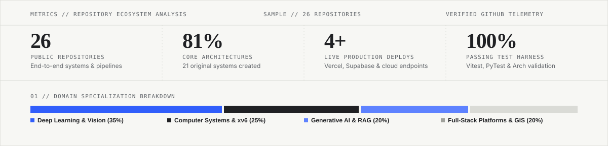

<p align="center">
  <picture>
    <source media="(prefers-color-scheme: dark)" srcset="assets/profile-banner-dark.svg">
    <source media="(prefers-color-scheme: light)" srcset="assets/profile-banner.svg">
    
  </picture>
</p>

<p align="center">
  <strong>Tirumala Sai Raghava Sreekar</strong> &nbsp;·&nbsp; 
  <code>IIITDM Kancheepuram</code> &nbsp;·&nbsp; 
  <code>Chennai, India</code> &nbsp;·&nbsp; 
  <a href="mailto:sreekartirumala0706@gmail.com">sreekartirumala0706@gmail.com</a>
</p>

<p align="center">
  <a href="#-telemetry--statistical-distribution">Telemetry</a> &nbsp;·&nbsp;
  <a href="#-interpretational-systems-architecture">Architecture Diagram</a> &nbsp;·&nbsp;
  <a href="#-featured-systems-engineering">Flagship Showcases</a> &nbsp;·&nbsp;
  <a href="#-complete-repository-index">All Repositories</a> &nbsp;·&nbsp;
  <a href="#-technical-toolkit">Toolkit</a> &nbsp;·&nbsp;
  <a href="#-active-research-vectors">Research</a> &nbsp;·&nbsp;
  <a href="#-connect">Contact</a>
</p>

---

### 00 // Telemetry &amp; Statistical Distribution

<p align="center">
  <picture>
    <source media="(prefers-color-scheme: dark)" srcset="assets/profile-stats-dark.svg">
    <source media="(prefers-color-scheme: light)" srcset="assets/profile-stats.svg">
    
  </picture>
</p>

```
[SYSTEMS METRIC AUDIT]
├── Total Repositories Analyzed : 26 Projects
├── Original Core Codebases     : 21 Repositories (81% Original Systems)
├── Production Live Deployments : 4 Web & Cloud Applications
├── Technical Stack Allocation  : Python (35%) · C/C++ (18%) · TypeScript/React (22%) · Kotlin & POSIX (15%) · Notebooks (10%)
└── Primary Research Vertices   : Generative AI & RAG · Vision Transformers (Swin/ViT) · CXL 2.0/PIM Sim · xv6 OS
```

---

### 01 // Interpretational Systems Architecture

The diagram below maps the four-tier architectural continuum connecting low-level hardware constraints to production-grade distributed user interfaces:

```mermaid
flowchart TB
    %% Global Styling
    classDef hardware fill:#F7F7F4,stroke:#202124,stroke-width:1.5px,color:#202124;
    classDef deeplearning fill:#EEF2FF,stroke:#315EFB,stroke-width:1.5px,color:#202124;
    classDef genai fill:#F0FDF4,stroke:#16A34A,stroke-width:1.5px,color:#202124;
    classDef app fill:#FAF5FF,stroke:#9333EA,stroke-width:1.5px,color:#202124;

    subgraph L4 ["LAYER 04 // PRODUCTION PLATFORMS & REAL-TIME INTERFACES"]
        direction LR
        APP_YT["<b>YouTube Sage UI</b><br/>React · Vercel Edge<br/><code>youyap.vercel.app</code>"]:::app
        APP_CIVIC["<b>CivicLens Spatial Registry</b><br/>React 19 · Leaflet GIS · Vite<br/><code>quicksort-civiclens.vercel.app</code>"]:::app
        APP_API["<b>Telemetry &amp; Persistence</b><br/>FastAPI · Supabase (PostgreSQL)<br/><code>Docker Container Runtime</code>"]:::app
    end

    subgraph L3 ["LAYER 03 // AGENTIC RETRIEVAL &amp; GENERATIVE REASONING"]
        direction LR
        RAG_CORE["<b>LangChain LCEL Agent</b><br/>Tool-Calling Runtime<br/><code>search_transcript &amp; memory</code>"]:::genai
        RAG_VEC["<b>High-Density Vector Store</b><br/>FAISS · Sentence Transformers<br/><code>Semantic Chunk Partitioning</code>"]:::genai
        RAG_INF["<b>Hardware-Accelerated LLM</b><br/>Groq LPU (Llama-3 / Gemma-2)<br/><code>Sub-Second Generation</code>"]:::genai
    end

    subgraph L2 ["LAYER 02 // APPLIED DEEP LEARNING &amp; SPATIAL MODELING"]
        direction LR
        DL_SWIN["<b>SwinGeo UHI Transformer</b><br/>Shifted-Window Attention<br/><code>PyTorch 2.x · XAI Attribution</code>"]:::deeplearning
        DL_SAT["<b>Multi-Spectral Telemetry</b><br/>Landsat 8 Radiometric Bands<br/><code>NDVI / NDBI Thermal Reg.</code>"]:::deeplearning
        DL_CLINICAL["<b>Clinical Early-Warning</b><br/>Multi-Vital Time-Series<br/><code>Sepsis Anomaly Scoring</code>"]:::deeplearning
    end

    subgraph L1 ["LAYER 01 // COMPUTER SYSTEMS &amp; ARCHITECTURE SIMULATION"]
        direction LR
        SYS_XV6["<b>Operating System Kernel</b><br/>xv6 Unix Internals · C<br/><code>Syscall Tracing &amp; Logging</code>"]:::hardware
        SYS_MEM["<b>MemCentric-Sim</b><br/>CXL 2.0 &amp; HBM-PIM Simulator<br/><code>Heterogeneous Workload Routing</code>"]:::hardware
        SYS_LAN["<b>LAN Streaming Engine</b><br/>POSIX Socket Programming<br/><code>Low-Latency Video/Audio Stream</code>"]:::hardware
    end

    %% Data and Execution Flow
    SYS_MEM -. "Mitigate Von Neumann Memory Wall" .-> DL_SWIN
    SYS_XV6 -. "Process & Buffer Instrumentation" .-> SYS_LAN
    DL_SAT ==> "Multi-Spectral Embeddings" ==> DL_SWIN
    DL_SWIN ==> "Contextual Representation" ==> RAG_VEC
    RAG_VEC --> RAG_CORE
    RAG_INF --> RAG_CORE
    RAG_CORE ==> "JSON API & Session Tokens" ==> APP_YT
    APP_API <==> "Real-Time Spatial Sync" <==> APP_CIVIC
```

---

### 02 // Featured Systems Engineering

> High-impact implementations engineered with production rigor, modular API boundaries, and hardware-conscious execution.

<br>

#### 01 / YouTube Sage — Multi-Modal Video RAG &amp; Agentic Retrieval Engine
> **Autonomous transcript synthesis, contextual question-answering, and tool-augmented LLM orchestration.**

```
[SYSTEM TOPOLOGY: YOUTUBE SAGE]
YouTube Ingestion ──> Audio Transcript ──> Recursive Splitter ──> FAISS Index
                                                                        │
Query ──> Tool-Calling Agent [Groq LPU / Llama-3] <── Sub-Second Search ┘
      ──> Fast Response ──> FastAPI Session Store ──> React Client (youyap.vercel.app)
```

- **Production Deployment:** [**youyap.vercel.app**](https://youyap.vercel.app) &nbsp;|&nbsp; **Source Code:** [`Sreekar-2612/Youtube-Sage`](https://github.com/Sreekar-2612/Youtube-Sage)
- **Technical Architecture:** Built with **LangChain LCEL**, **FastAPI**, **Groq LPU hardware acceleration (Llama-3)**, **Hugging Face Hub**, **FAISS**, and **React**.
- **Key Engineering Highlights:**
  - **Dual-Inference Backend:** Leveraged Groq LPUs for sub-second conversational token generation paired with Hugging Face endpoints for flexible embedding extraction.
  - **Dynamic Tool Calling:** Implemented autonomous agent tools (`search_transcript`, recursive summarization) backed by conversational session memory.
  - **Timestamp Preservation:** Engineered custom text-splitting heuristics that retain video timestamp metadata across chunk boundaries.
  - **Containerized Service:** Decoupled FastAPI backend containerized with Docker, maintaining ephemeral session state across user interactions.

<br>

#### 02 / CivicLens (QuickSort) — Civic Infrastructure Spatial Registry &amp; Coordination OS
> **Enterprise-grade municipal coordination platform aligning excavation schedules and eliminating repeat road-cutting.**

- **Production Deployment:** [**quicksort-civiclens.vercel.app**](https://quicksort-civiclens.vercel.app/) &nbsp;|&nbsp; **Source Code:** [`Sreekar-2612/CivicLens`](https://github.com/Sreekar-2612/CivicLens)
- **Technical Architecture:** Built with **React 19**, **TypeScript**, **Supabase (PostgreSQL &amp; Edge Functions)**, **Leaflet GIS**, **Vite**, **Recharts**, and **Vitest**.
- **Key Engineering Highlights:**
  - **Spatial Conflict Detection:** Multi-layer GIS engine displaying concurrent municipal permits to proactively prevent duplicate road excavation.
  - **Strict Type Safety &amp; Testing:** Comprehensive data models enforced via TypeScript, validated with Oxlint and automated Vitest suites.
  - **Real-Time Municipal Telemetry:** Interactive audit trails, contractor progress verification, and analytical dashboards rendered with Recharts.

<br>

#### 03 / SwinGeo — Hierarchical Shifted-Window Transformer for UHI Mapping
> **High-resolution Land Surface Temperature (LST) regression and microclimate anomaly modeling from satellite telemetry.**

- **Research Repository:** [`Sreekar-2612/LAND_SURFACE_TEMPERATURE_PREDICTION_USING_TRANSFORMERS`](https://github.com/Sreekar-2612/LAND_SURFACE_TEMPERATURE_PREDICTION_USING_TRANSFORMERS)
- **Technical Architecture:** Implemented in **PyTorch 2.x**, leveraging **Swin Transformer** architectures, **Landsat 8 multispectral imagery**, and **Explainable AI (XAI)**.
- **Key Engineering Highlights:**
  - **Shifted Window Attention:** Restricted self-attention to local shifted windows, enabling cross-patch spatial feature learning without quadratic computational complexity.
  - **Radiometric Calibration:** Ingested raw Landsat 8 optical and thermal infrared bands; computed vegetation and urban indices (NDVI, NDBI).
  - **Attribution &amp; Bias Correction:** Integrated attribution mechanisms (XAI) and empirical bias-correction models to evaluate predictions against physical sensor readings.

<br>

#### 04 / MemCentric-Sim — Heterogeneous PIM/CXL Dynamic Scheduling Simulator
> **Cycle-accurate computer architecture simulation modeling Processing-in-Memory and CXL 2.0 interconnects.**

- **Research Repository:** [`Sreekar-2612/Memory-Centric-Computing-Dynamic-Scheduling-Simulator`](https://github.com/Sreekar-2612/Memory-Centric-Computing-Dynamic-Scheduling-Simulator)
- **Technical Architecture:** Developed in **Python 3.10+**, modeling **CXL 2.0 interconnect latency**, **HBM-PIM memory banks**, **L1/L2 caches**, and **CPU host cores**.
- **Key Engineering Highlights:**
  - **Dynamic Task Offloading:** Formulated heuristics to dynamically dispatch memory-bandwidth-bound tasks to in-memory logic while routing compute-bound operations to host cores.
  - **Memory Wall Mitigation:** Modeled latency and energy reductions achieved by bypassing host bus data transfers for memory-intensive kernel execution.
  - **Verification Rigor:** Automated unit and regression test suite achieving a 100% pass rate, adhering to IEEE/ACM Micro academic evaluation standards.

---

### 03 // Complete Repository Index

Every single project from my GitHub profile is verified and organized below by technical domain:

<details open>
<summary><b>01 // Systems Programming, OS Internals &amp; Networking</b> (3 Projects)</summary>
<br>

| Repository | Scope &amp; Implementation | Stack |
| :--- | :--- | :--- |
| [**Kernel_Logging**](https://github.com/Sreekar-2612/Kernel_Logging) | Operating system kernel logging, syscall tracing, and buffer inspection inside xv6 Unix. | `C` · `xv6 Unix` · `GDB` · `OS Internals` |
| [**LAN Video Conferencing**](https://github.com/Sreekar-2612/VIDEO-CONFERENCING-APPLICATION-WORKING-ON-LOCAL-AREA-NETWORK) | Zero-internet local area network streaming engine: real-time video, audio, screen share &amp; file transfer. | `Python` · `Socket API` · `Multithreading` · `OpenCV` |
| [**CN_PROJECT**](https://github.com/Sreekar-2612/CN_PROJECT) | Low-level computer network protocol implementations, packet socket routing, and flow control. | `Python / C` · `TCP/IP` · `Socket Networking` |

</details>

<br>

<details open>
<summary><b>02 // Deep Learning, Computer Vision &amp; Biomedical AI</b> (4 Projects)</summary>
<br>

| Repository | Scope &amp; Implementation | Stack |
| :--- | :--- | :--- |
| [**Urban Hotspots Prediction**](https://github.com/Sreekar-2612/Urban_Hotspots_Prediction_Using_VisionTransformer) | Deep learning pipeline predicting urban thermal hotspots via CNNs and Landsat 8 satellite data. | `Python` · `PyTorch` · `Landsat 8` · `NDVI / NDBI` |
| [**Brain Tumor CLIP Segmentation**](https://github.com/Sreekar-2612/BRAIN_TUMOR_SEGMENTATION_USING_CLIP_ARCHITECTURE) | Biomedical MRI segmentation leveraging vision-language alignment and multimodal embeddings. | `Python` · `PyTorch` · `CLIP` · `Medical Imaging` |
| [**Geospatial Classification**](https://github.com/Sreekar-2612/Geospatial-Classification-Framework) | Multispectral satellite imagery classification and land-use segmentation pipelines. | `Jupyter` · `Scikit-Learn` · `Rasterio` · `Remote Sensing` |
| [**Fashion-MNIST CNN Pipeline**](https://github.com/Sreekar-2612/End-to-End-Convolutional-Neural-Network-for-Fashion-MNIST-Classification-Using-PyTorch) | Modular end-to-end convolutional neural network with checkpointing and evaluation curves. | `PyTorch` · `Torchvision` · `CNN Architectures` |

</details>

<br>

<details open>
<summary><b>03 // Clinical AI, Time-Series &amp; Predictive Analytics</b> (4 Projects)</summary>
<br>

| Repository | Scope &amp; Implementation | Stack |
| :--- | :--- | :--- |
| [**Multi-Vital Sepsis Monitor**](https://github.com/Sreekar-2612/Multi-Vital-Sepsis-Monitor) | Personalized clinical early-warning system detecting sepsis onset from multi-vital time-series streams. | `Python` · `Clinical ML` · `Anomaly Scoring` · `Feature Eng.` |
| [**HetNet Traffic Forecast**](https://github.com/Sreekar-2612/hetnet-traffic-forecast) | Cellular traffic forecasting modeling dynamic load demands in heterogeneous 4G/5G networks. | `Python` · `Time-Series` · `Pandas` · `Scikit-Learn` |
| [**Diabetes Risk Prediction**](https://github.com/Sreekar-2612/Diabetes-Prediction-Using-Pytorch) | Deep feedforward neural network pipeline for diagnostic clinical risk classification. | `PyTorch` · `Binary Classification` · `Tabular ML` |
| [**Space Decay Trajectory**](https://github.com/Sreekar-2612/Space-decay-prediction-machine-learning-project) | Orbital decay modeling estimating satellite atmospheric re-entry profiles over time. | `Python` · `Regression` · `Orbital Mechanics` · `Pandas` |

</details>

<br>

<details open>
<summary><b>04 // Full-Stack Platforms, Mobile Software &amp; Services</b> (5 Projects)</summary>
<br>

| Repository | Scope &amp; Implementation | Stack |
| :--- | :--- | :--- |
| [**TEAM_FORGE**](https://github.com/Sreekar-2612/TEAM_FORGE) | Full-stack project management and collaborative team formation engine. *(<a href="https://team-forge-backend-nine.vercel.app">Live Backend</a>)* | `JavaScript` · `Node.js` · `Express` · `REST API` · `Vercel` |
| [**FacultyAPP**](https://github.com/Sreekar-2612/FacultyAPP) | Native Android mobile application streamlining faculty schedules, student requests, and notices. | `Kotlin` · `Android SDK` · `Material Architecture` |
| [**Futura Fintech**](https://github.com/Sreekar-2612/futura-fintech) | Modern digital financial operations dashboard and asset transfer interface. *(<a href="https://digital-rebel.vercel.app">Live App</a>)* | `React / JS` · `Fintech UI` · `Vercel` |
| [**Restaurant Management**](https://github.com/Sreekar-2612/restaurant-management-system) | Structured multi-tier ordering, billing, table management, and inventory tracking application. | `Java / Web` · `Database Schema` · `CRUD Workflows` |
| [**Urban Service Intelligence**](https://github.com/Sreekar-2612/urban-service-intelligence) | Municipal asset telemetry framework and urban public works analytics. | `Python` · `Data Pipelines` · `Urban Computing` |

</details>

<br>

<details open>
<summary><b>05 // Algorithmic Problem Solving &amp; Scientific Foundations</b> (5 Projects)</summary>
<br>

| Repository | Scope &amp; Implementation | Stack |
| :--- | :--- | :--- |
| [**NeetCode Submissions**](https://github.com/Sreekar-2612/neetcode-submissions) | Optimized algorithmic solutions across dynamic programming, graph theory, trees, heaps, and arrays. | `Python` · `Data Structures &amp; Algorithms` |
| [**Email Spam Detection**](https://github.com/Sreekar-2612/email-spam-detection) | NLP text vectorization and probabilistic classification for spam filtering. | `Python` · `NLP` · `TF-IDF / Naive Bayes` · `Scikit-Learn` |
| [**COVID-19 Epidemiological Analytics**](https://github.com/Sreekar-2612/COVID-19-Data-Visualization-Analysis) | Spatio-temporal pandemic progression and transmission trend visualization. | `Python` · `Matplotlib` · `Seaborn` · `Data Viz` |
| [**Netflix Catalog Analysis**](https://github.com/Sreekar-2612/Netflix-Data-Analysis) | Content release trajectories, regional distribution, and genre clustering exploratory analysis. | `Python` · `Pandas` · `Exploratory Data Analysis` |
| [**Stanford ML Foundations**](https://github.com/Sreekar-2612/Coursera-Machine-Learning-Stanford) | Mathematical implementations of gradient descent, backpropagation, SVMs, and PCA. | `Octave / Python` · `Linear Algebra` · `Optimization` |

</details>

---

### 04 // Technical Toolkit

```
┌─────────────────────────┬─────────────────────────────────────────────────────────────────────────────┐
│ Category                │ Verified Technologies & Tools                                               │
├─────────────────────────┼─────────────────────────────────────────────────────────────────────────────┤
│ Languages               │ Python 3.x · C · C++ · TypeScript · JavaScript · Kotlin · SQL (PostgreSQL)  │
│ Generative AI & RAG     │ LangChain (LCEL) · Tool-Calling Agents · FAISS · Groq LPU · Hugging Face    │
│ Deep Learning & Vision  │ PyTorch 2.x · Swin Transformers · Vision Transformers (ViT) · CNNs · CLIP   │
│ Systems & Architecture  │ xv6 Unix Kernel · CXL 2.0 / PIM Simulation · Socket Programming · GDB       │
│ Full-Stack & Platforms  │ React 19 · Vite · FastAPI · Node.js · Supabase · Docker · Leaflet GIS       │
│ Quality & Deployment    │ Vitest · Oxlint · Git / GitHub Actions · Vercel Cloud · Linux Environments  │
└─────────────────────────┴─────────────────────────────────────────────────────────────────────────────┘
```

---

### 05 // Active Research Vectors

- **Sub-Second Multi-Modal Agent Orchestration:** Exploring speculative decoding, asynchronous tool-calling graphs, and quantized local inference to minimize round-trip latencies in conversational video synthesis.
- **Hierarchical Attention on High-Dimension Earth Observation Data:** Adapting shifted-window vision transformer variants to fuse thermal infrared, SAR, and optical earth observation data for microclimate hazard forecasting.
- **Memory-Centric Dynamic Offloading in Heterogeneous Runtimes:** Designing scheduling heuristics for CXL-attached memory accelerators to minimize bandwidth contention in LLM inference caches.

---

### 06 // Engineering Principles

1. **First-Principles Rigor Over Black-Box Intuition:** Understand how data moves across the physical bus, through the kernel socket buffers, and into the GPU memory pool. If you cannot explain the hardware or runtime cost, the abstraction is unproven.
2. **Production Viability Over Synthetic Demos:** Toy scripts are easy to show; resilient systems are hard to break. I prioritize typed API boundaries, comprehensive error isolation, real-world datasets, and measurable latency benchmarks.
3. **Restrained, Purposeful Craft:** From code organization to user interface design, clarity is paramount. Eliminate visual noise, superfluous dependencies, and speculative complexity. Let the function dictate the form.

---

### 07 // Connect &amp; Collaborate

I welcome discussions regarding engineering roles, systems research, Generative AI infrastructure, and collaborative open-source development:

- **Email:** <a href="mailto:sreekartirumala0706@gmail.com"><code>sreekartirumala0706@gmail.com</code></a>
- **GitHub:** <a href="https://github.com/Sreekar-2612"><code>@Sreekar-2612</code></a>
- **Academic Affiliation:** Indian Institute of Information Technology, Design and Manufacturing (IIITDM), Kancheepuram
- **Location:** Chennai, Tamil Nadu, India

<br>

<p align="center">
  <sub>Designed with the Swiss International Typographic System · Monospace Precision · Verified Implementations</sub>
</p>
