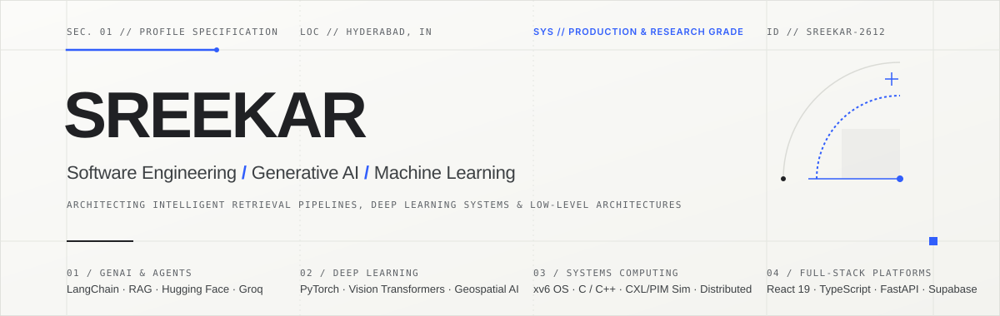
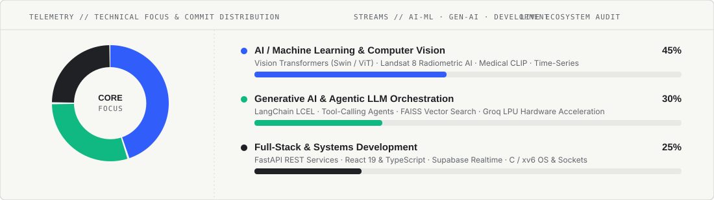

  <picture>
    <source media="(prefers-color-scheme: dark)" srcset="assets/profile-banner-dark.svg">
    <source media="(prefers-color-scheme: light)" srcset="assets/profile-banner.svg">
    
  </picture>

  <strong>Tirumala Sai Raghava Sreekar</strong> &nbsp;·&nbsp; 
  <code>IIITDM Kancheepuram</code> &nbsp;·&nbsp; 
  <code>Chennai, India</code>

  <em>"Slow is smooth, smooth is fast. Consistency over intensity."</em>

  <a href="#-socials">Socials</a> &nbsp;·&nbsp;
  <a href="#-about-me">About Me</a> &nbsp;·&nbsp;
  <a href="#-technical-stream--commit-distribution">Distribution</a> &nbsp;·&nbsp;
  <a href="#-tech-stack">Tech Stack</a> &nbsp;·&nbsp;
  <a href="#-connect">Contact</a>

---

### 🌐 Socials

  
  &nbsp;
  
  &nbsp;
  

---

### ☕ About Me

> 🧊 *"Stay curious, build with patience, and let steady compounding do the heavy lifting."*  
> 🌊 *Chill vibes, consistent code, and grounded first-principles thinking.*

I am a Computer Science &amp; Engineering Dual Degree undergraduate at **IIITDM Kancheepuram**, working at the intersection of **Artificial Intelligence &amp; Machine Learning**, **Generative AI Systems**, and **Modern Software Engineering**.

- **Focus &amp; Flow:** I believe in consistent, daily momentum rather than sporadic bursts. I spend my time exploring deep learning architectures, building agentic RAG workflows, and writing clean, reliable code.
- **AI &amp; Deep Learning:** Researching and implementing Vision Transformers (Swin / ViT), multispectral remote sensing radiometric pipelines, and medical signal anomaly detection.
- **Generative AI &amp; Agents:** Designing low-latency retrieval-augmented generation (RAG) systems with autonomous tool-calling agents, dense vector search (FAISS), and hardware acceleration (Groq LPUs).
- **Development &amp; Systems:** Developing modular backends (FastAPI, Docker, Supabase) and reactive web interfaces (React 19, TypeScript, Vite) with an appreciation for operating systems and low-level computer architecture.

---

### 📊 Technical Stream &amp; Commit Distribution

  <picture>
    <source media="(prefers-color-scheme: dark)" srcset="assets/stream-distribution-dark.svg">
    <source media="(prefers-color-scheme: light)" srcset="assets/stream-distribution.svg">
    
  </picture>

  
  &nbsp;
  

---

### 💻 Tech Stack

#### 🧠 AI / ML &amp; Deep Learning

  
  
  
  
  
  
  

#### ⚡ Generative AI &amp; LLM Systems

  
  
  
  
  
  

#### 🛠️ Backend, Cloud &amp; Infra

  
  
  
  
  
  
  

#### 💻 Frontend &amp; Web Development

  
  
  
  
  
  

#### ⚙️ Systems &amp; Low-Level Computing

  
  
  
  
  

---

### 📬 Connect

- **Email:** <a href="mailto:sreekartirumala0706@gmail.com"><code>sreekartirumala0706@gmail.com</code></a>
- **GitHub:** <a href="https://github.com/Sreekar-2612"><code>@Sreekar-2612</code></a>
- **University:** Indian Institute of Information Technology, Design and Manufacturing (IIITDM), Kancheepuram
- **Location:** Chennai / Hyderabad, India

 

  Built with Light Sky Blue Theme · Consistency · Calm Execution

